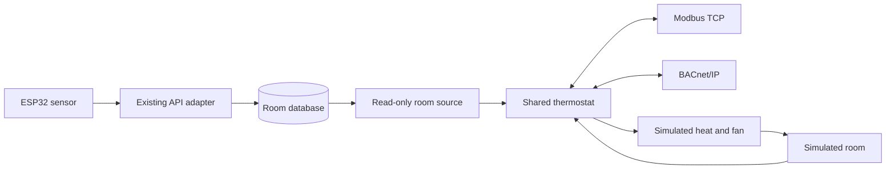

# Room readings as building-control points

I wanted to do something with my desk-node room log beyond saving numbers. This
bridge lets me ask for a comfortable temperature, see a heating decision, and
check that two different building-control clients see the same room and settings.
Everything runs on my computer. Heat and fan are simulated outputs.

## Try it without a board

From the repository root, install Python 3.11+ and run:

```sh
python3 -m venv .venv
.venv/bin/python -m pip install -r automation/requirements.txt
.venv/bin/python -m automation.gateway --demo
```

In a second terminal in that folder:

```sh
.venv/bin/python -m automation.check
```

The check discovers device 12001, reads temperature and humidity, sets a 30 C
target over Modbus, checks the resulting heat demand over BACnet, then sets a
10 C target over BACnet and checks that Modbus shows heat and fan off. It restores
the previous settings in its cleanup path. Run it against the synthetic demo:
the check expects a fresh room temperature between the two test targets.
It prints five successful checks and the readings as JSON. An assertion or network
failure exits with an error instead of claiming success.

The server defaults to the local computer only: TCP 1502 and UDP 47808. The check
temporarily uses UDP 47809. For occupied ports, pass `--modbus-port 1503
--bacnet-port 47810` to both commands and `--client-port 47811` to the check.
Ctrl-C or SIGTERM stops the server. Its startup JSON identifies its owner, PID,
start time, ports and exact stop command. No background process is installed.

## Use my ESP32 readings

The ESP32 already sends samples to [desk_api.py](../firmware/tools/desk_api.py),
which saves them in a local SQLite database, a file containing tables. Run that
adapter using its [existing setup](../firmware/README.md#lifeos-api-adapter).
Then run this bridge alongside it, using its database path and the device's
12-character lowercase hexadecimal ID:

```sh
.venv/bin/python -m automation.gateway \
  --database /absolute/private/path/room.sqlite3 --device abcdef123456
```

The example ID is fictional. The bridge opens the database read-only and never
reads LifeOS cookies or device tokens. It only reads this device's temperature,
humidity and measurement time. It does not change notes or the existing adapter.
No firmware changes are required. Samples with timestamp zero have no synchronized
measurement time, so they cannot drive the thermostat. Delayed backlog uploads
cannot replace a newer measurement: selection is by sample time, then receipt
order for equal times, within the selected device.

The board normally samples about every five minutes. The default freshness limit
is 900 seconds; `--max-age` changes it in the range 1 to 86400 seconds. This is a
slow room-monitor demonstration, unsuitable for equipment that needs rapid feedback.

## How a building uses these connections

A building automation system (BAS) brings equipment readings, schedules and
commands into one supervisory system. Heating, ventilation and air conditioning
(HVAC) controllers keep local temperature and airflow near their targets. The
supervisor can change occupied-hour targets and collect trends; local controllers
still need their own protective logic if that connection disappears.

BACnet is designed to exchange building equipment data across vendors, including
HVAC and lighting. It represents each reading or setting as an object with named
properties, such as a temperature's value, units and fault status. A client can
discover a device and read those properties. See the
[BACnet Committee's introduction](https://bacnet.org/about-bacnet-standard/).

Modbus exposes numbered registers and bits. The device's register map tells the
client what each number means, how values are scaled and which are writable. In
an electrical monitoring integration, a register map might assign addresses to
power, voltage, energy and breaker status; a BAS gateway translates those into
named points for trends and alarms. That electrical example explains a possible
integration, rather than a meter implemented here. The
[Modbus specifications](https://www.modbus.org/modbus-specifications) define its
function codes and TCP messaging.

This desk node supplies one room's sensor points and one heating loop. It does
not implement electrical metering, whole-building scheduling, cooling, damper
control or life-safety functions. A commercial installation also needs engineered
sequences, actuator feedback, equipment interlocks and commissioning against the
actual equipment, beyond this software exercise.

## Data flow and thermostat



The bridge chooses one source at startup: the database or the simulation. One
asyncio event loop, Python's task scheduler, owns all readings, settings and
outputs. A tick runs every 0.5 seconds; protocol writes also refresh the loop.
Neither protocol keeps a separate thermostat. Setpoint is the desired temperature,
default 22 C. Deadband is a full-width zone around it, default 1 C:

- At or below `setpoint - deadband/2`, heat and fan turn on.
- At or above `setpoint + deadband/2`, both turn off.
- Inside that zone, they keep their previous state. This hysteresis prevents
  repeated switching for tiny changes near the target.
- Missing, invalid, future-dated or stale samples force both outputs off and
  raise the sensor fault. A new valid sample allows normal control again.

Setpoints must be finite and between 10 and 30 C. Deadband must be finite and
between 0.2 and 5 C. Invalid changes are rejected. Multi-register writes validate
both settings before changing either. Settings start at defaults after a restart;
they are not persisted. Both protocols write the same state; the last accepted
write wins. There is no priority arbitration or direct output override.

The simulation starts at 20 C with 45% relative humidity. It models heat loss
toward 18 C surroundings and adds heat while demand is on. Its accelerated rate
lets the loop turn heat off and on within a short demonstration; it is not a
calibrated thermal model or an estimate of my actual room's energy consumption.

## Modbus TCP map

Use unit/device ID **1**, default TCP port **1502**, with zero-based **wire
addresses** below. Some tools display holding register 0 as 40001 and input
register 0 as 30001. Select the register table as well as its address.

| Table / function | Wire address | Meaning | Encoding / access |
| --- | --- | --- | --- |
| Input registers / FC04 | 0 | Temperature | Signed 16-bit, C x 100, read-only |
| Input registers / FC04 | 1 | Relative humidity | Percent x 100, read-only |
| Input registers / FC04 | 2 | Heat demand | 0 or 1, read-only |
| Input registers / FC04 | 3 | Fan demand | 0 or 1, read-only |
| Input registers / FC04 | 4 | Sensor fault | 1 means unusable sample, read-only |
| Input registers / FC04 | 5 | Sample age | Whole seconds, saturates at 65535; unknown = 65535 |
| Holding registers / FC03, FC06, FC16 | 0 | Setpoint | C x 100, read/write |
| Holding registers / FC03, FC06, FC16 | 1 | Full deadband width | C x 100, read/write |
| Discrete inputs / FC02 | 0, 1, 2 | Heat, fan, sensor fault | Boolean, read-only |

No coils or other addresses are implemented. Unsupported operations, unmapped
addresses and invalid setting values return Modbus exceptions. Words use standard
Modbus network byte order. Decode temperatures >=32768 by subtracting 65536
before dividing by 100, so `65011` means -5.25 C. No multiword byte ordering is
involved. After startup without a reading, numeric sensor points are zero; always
check fault before interpreting them. Old readings remain visible if stale, with
fault set; a missing or invalid reading exposes zeros with fault set.

## BACnet/IP map

Default device instance **12001**, name **Desk room simulator**, UDP port **47808**.
This is an unregistered simulated device using BACpypes3's sample vendor ID 999,
not a certified commercial device. `--instance` selects another device instance.
Who-Is/I-Am discovery and ReadProperty/WriteProperty use real BACnet datagrams.
The supplied check uses directed Who-Is so it works on loopback without broadcast.

| Object | Name / units | Access |
| --- | --- | --- |
| analog-input,0 | Room temperature / degrees Celsius | Read-only |
| analog-input,1 | Room humidity / percent relative humidity | Read-only |
| analog-value,0 | Heating setpoint / degrees Celsius | Present_Value writable |
| analog-value,1 | Full deadband width / degrees Celsius | Present_Value writable |
| binary-value,0 | Simulated heat output / active or inactive | Read-only |
| binary-value,1 | Simulated fan output / active or inactive | Read-only |
| binary-value,2 | Sensor fault / active means unusable | Read-only |

The device's Object_List also includes its device and network-port objects.
Sensor Status_Flags sets the fault bit and Reliability becomes `unreliable-other`
when input is unusable. Check fault even when a numeric Present_Value is available.
Only the two settings accept remote writes; all other points, device identity
and network configuration reject writes. Settings are ordinary analog values,
not commandable outputs: writes with a priority or array index are rejected.
There is no BACnet priority array or relinquish-default behavior in this demo.

Keep both services on loopback for the walkthrough. For an isolated lab LAN, bind
`--host <computer IPv4 address> --allow-lan`, configure the client for that address,
and permit only the chosen ports on that interface. The built-in check is for
the same computer. This implements plain Modbus TCP and BACnet/IP, without
authentication or encryption. Do not expose them to the internet or connect them
to real HVAC equipment. It is not BACnet/SC or Modbus Security. Cross-subnet
BACnet broadcast routing and BBMD configuration are outside this demonstration.

## Implementation and checks

`automation/control.py` owns validation and hysteresis; `sources.py` reads the
existing database or advances the thermal model. `protocols.py` maps both network
stacks to that shared state, and `gateway.py` owns scheduling and shutdown.
`check.py` is an executable client walkthrough. Dependencies are pinned in
`automation/requirements.txt`, including the BACpypes3 UDP transport interface
used to await readiness and clean up incomplete startup.

```sh
firmware/tests/run_host_tests.sh
.venv/bin/python -m unittest discover -s automation/tests -v
```

The existing suite checks 52 C core cases, 22 peripheral cases and 17 Python
adapter tests. The 30 new Python tests check hysteresis boundaries, multiple
closed-loop cycles, invalid settings, atomic writes, signed encoding, freshness,
read-only database selection, and real TCP/UDP reads and writes. They also check
discovery, units, object lists, fault recovery, read-only points, adapter ingestion
through to both protocols, failed-start cleanup, port release and graceful SIGTERM of the actual CLI.
Fixtures use temporary files and ephemeral ports, close clients and servers in
cleanup paths and wait for their owned child process. No physical outputs run.
GitHub CI runs these on Python 3.11 and 3.12 alongside the existing firmware
checks and ESP32 builds. Hardware performance and commercial interoperability
still need physical commissioning and independent device testing.
