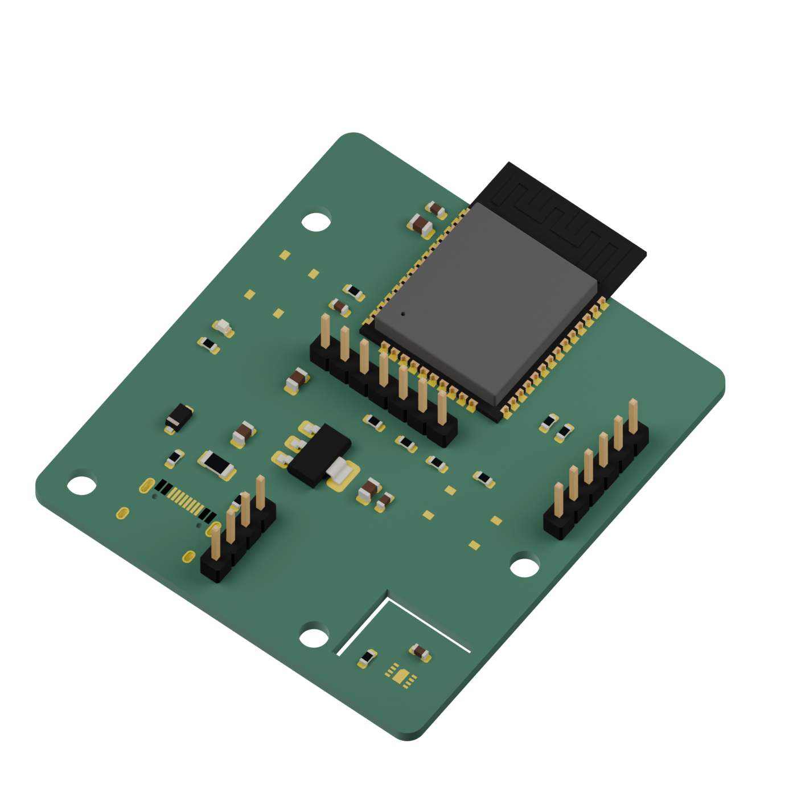
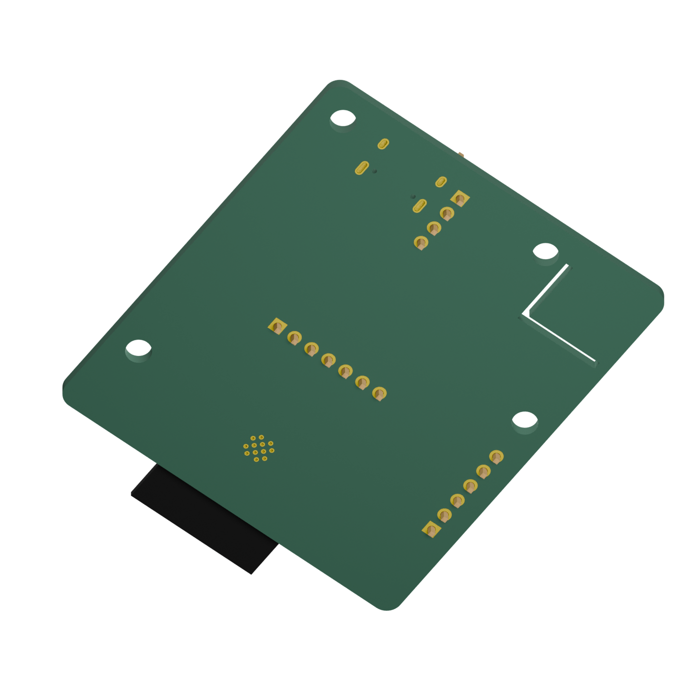

# Desk node board

I built a circuit-board design for my LifeOS desk gadget because I wanted its controller, room sensor and screen connections in one place.

## Overview

I want to see what is coming up without opening LifeOS, and keep a record of the room conditions while I work. This board brings the controller, room sensor and power supply together. A small screen plugs into it to show the next class or deadline; the firmware sends temperature and humidity readings back to LifeOS over Wi-Fi.

This is a personal project. The board has been checked in KiCad and CI, but it has not been manufactured or tested on a desk yet.

## What plugs into it

- **USB-C power:** use a regulated 5 V wall supply rated for at least 1 A. This connector supplies power only.
- **Screen:** a seven-pin SSD1306 128 × 64 display configured for four-wire SPI plugs into J4. Its pins must be GND, 3V3, SCLK, MOSI, RESET, D/C, CS in that order.
- **Programming adapter:** a 3.3 V USB-to-UART adapter plugs into J3 to load firmware and read logs. Connect its ground, TX and RX; leave its power lead disconnected when USB power is connected.
- **Optional expansion:** J2 exposes the sensor's I²C bus. The firmware also supports a four-pin I²C screen here when that option is selected instead of the SPI screen.

The temperature and humidity sensor is soldered directly to the board. The screen, USB supply, programming adapter and mounting hardware are separate purchases. There is no battery connection.

## Check the purchasing record

I keep [the component database](components/catalog.json) beside the drawing so I
can compare exact manufacturer part numbers and replacement candidates before I
order. The [parts guide](../docs/components.md) shows how to make an Excel
assembly package and load it into InvenTree, a free parts manager. The saved
[risk review](components/review/risk.md) flags an original capacitor that its
manufacturer no longer recommends for new designs. Missing RoHS and REACH
material declarations remain unverified, and replacements need qualification.

## Build or order a board

1. Open [desk-node.kicad_pro](desk-node.kicad_pro) in KiCad 8 to inspect the schematic and board layout.
2. Install KiCad 8's command-line tools, then run this from the repository root:

   ```sh
   hardware/scripts/export_fab.sh
   ```

3. The files appear in `hardware/fab/`. Upload `desk-node-gerbers.zip` to the board manufacturer. For assembly, use `desk-node-bom-jlcpcb.csv` and `desk-node-cpl-jlcpcb.csv`. The [parts list](bom.csv) includes supplier part numbers.
4. Review the manufacturer's board and assembly preview before paying. Check antenna clearance, connector direction, footprints and part rotations using the [ordering checklist](docs/design.md#review-by-eye-before-ordering). Confirm the slots and mounting holes fit the intended enclosure.
5. Assemble the board, connect the screen and programming adapter, and follow the [firmware build and flash steps](../firmware/README.md#build-and-flash). The [first-board checks](docs/design.md#review-by-eye-before-ordering) cover power, the screen, sensor readings and Wi-Fi operation.

You can also download `desk-node-fab` from a successful [hardware CI run](https://github.com/jackaI1/lifeos-desk-node/actions/workflows/hardware.yml). Use the artifact for the exact commit you intend to order. Supplier stock and assembly eligibility still need checking in the order preview.

## Board preview and design notes

The board is 50 × 55 mm. The antenna extends past its top edge, and slots separate the room sensor from the warmer controller and power supply.




These views show KiCad's available models. The exact USB-C socket, sensor and pushbuttons have no stock model, so their pads appear without the component bodies. Check their manufacturer drawings for physical fit.

The [board walkthrough](docs/walkthrough.md) explains the power and data connections and the project files in plain language. The [design notes](docs/design.md) cover the circuit, pin assignments, electrical limits, routing, regeneration and the ordering checklist. The [shared pinout](../docs/pinout.md) keeps the board and firmware connections in agreement.
