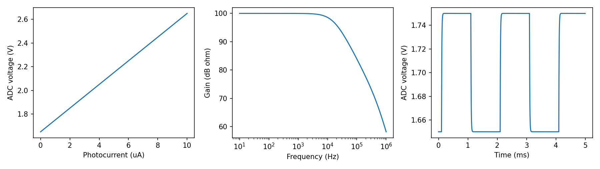

# Checking a light-sensor input before building it

I built a circuit simulation because I wanted to learn how a tiny sensor current
could become a voltage the desk node can read. The native KiCad drawing includes
a five-volt input, a 3.3-volt regulator, a half-supply reference and a photodiode
amplifier. This is a separate light-input experiment, not the existing digital
temperature sensor or a manufactured addition to the board.

```sh
.venv/bin/pip install -r hardware/simulation/requirements.txt
.venv/bin/python -m hardware.simulation.spice
.venv/bin/python -m pytest hardware/simulation/tests -q
```

These commands need `kicad-cli` and `ngspice`. I get DC, frequency and time-step
plots in `hardware/simulation/build/comparison.png`, the exact SPICE inputs,
raw data and `results.json`. The tool first exports the native drawing to a
KiCad netlist and checks that the feedback components connect to the actual
amplifier pins. It then uses the exported component values in the simulation.



## Hand calculation and results

A transimpedance amplifier turns current into voltage. A 100 kilohm feedback
resistor gives a gain of 100,000 volts per ampere. With the reference at 1.65 V,
a 1 microampere photocurrent should give 1.75 V. A 100 picofarad feedback
capacitor predicts a first-order bandwidth of 1/(2*pi*R*C), about 15.9 kHz.

In the local ngspice run I get 99,999 ohms of DC gain, 1.74998 V at the settled
step and a sampled -3 dB crossing near 16.8 kHz. The frequency sweep samples
40 points per decade, so the crossing is quantised. Tests allow 0.1% DC error,
1 mV step error and 12% bandwidth difference. Four tolerance corners and a
seeded 16-run Monte Carlo sweep vary the resistor by 1% and capacitor by 5%.

A separate supply-ripple run assumes 60 dB regulator attenuation at 1 kHz and
50 mV input ripple amplitude. It gives about 48 microvolts peak-to-peak at the
output, below the stated 100 microvolt budget. This is an explicit model
assumption, not a measured AP2112 or MCP6001 performance claim. The amplifier
model has finite 100,000 open-loop gain, a 1 MHz gain-bandwidth product, rail
limits and a 70 pF diode capacitance. It omits noise, offset, slew limiting,
temperature drift and detailed vendor transistor models. The drawing names
real candidate parts; this generic model cannot qualify them.

The leak-board nodal sweep varies probe resistance from 100 kilohms to
2 megohms at 3.0, 3.3 and 3.6 V. With the output high before the wet transition,
the ideal crossing is the parallel value of 1 and 10 megohms, about 909 kilohms;
ngspice's 10 kilohm grid finds 910 kilohms. It checks the analog input threshold,
not an electrical model of water or a real comparator's propagation delay.
