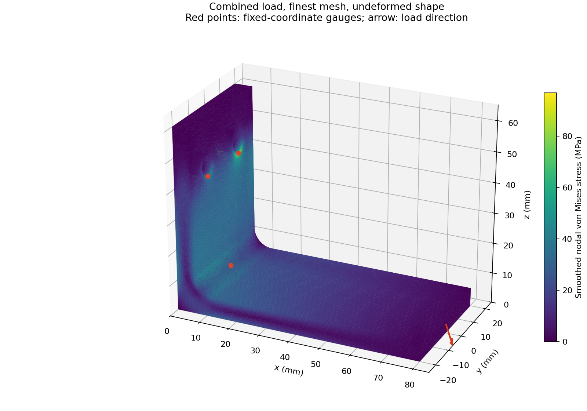
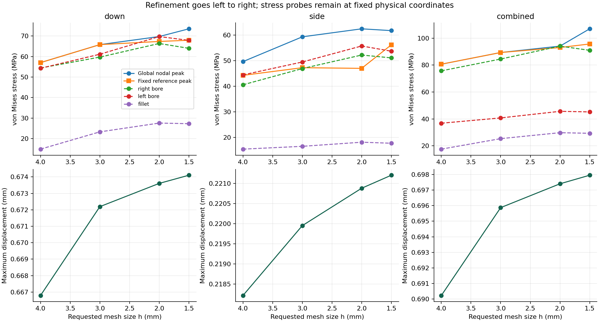

# Bracket study

I built this study to see how a bracket bends under load and to check how much the answer changes when I use smaller elements. These are numerical model results, not a rating for a manufactured bracket.

## Beam verification

A 100 mm cantilever has a 10 mm wide, 5 mm deep rectangular section, E = 70,000 MPa and a 10 N downward end force. It uses the same solid elements, traction integration and solver pipeline as the bracket.

`I = bh³/12 = 104.166667 mm⁴`; `tip deflection = PL³/(3EI)`; `bending stress = Mz/I`.

- Tip deflection: 0.453475 mm solved versus 0.457143 mm by hand (0.802% difference).
- Root stress by hand: 24 MPa. A least-squares comparison of computed axial stress against `P(L-x)z/I` at integration points 15 < x < 35 mm, |z| > 1 mm gives a ratio of 1.0000392 (0.0039% difference). The corresponding extrapolated root bending stress is 24.000940 MPa.
- Signed axial-stress field error over those points: 0.1786% RMS (norm of error / norm of prediction) and 0.7597% maximum pointwise relative error. The fitted scale above is an amplitude diagnostic, not a pointwise accuracy claim.
- I compare stress away from the fully fixed end because the local three-dimensional restraint violates the simple beam assumption there. The extrapolated root value is not the local clamp peak.
- Reaction force residual: 0.000116% of the applied load; 1,994 elements, 3,961 nodes.

## Bracket and loads

The L bracket is 80 mm long, 60 mm high, 40 mm wide and 6 mm thick, with a 6 mm inside fillet radius. Two 7 mm diameter mounting holes run through the upright in the x direction, at (y,z) = (±10,45) mm. All three translations on both cylindrical bores are fixed. There are no explicit bolt solids or contacts.

Forces act as constant traction over the entire 40 × 6 mm free end face at x = 80 mm. Six-node triangular face integration puts zero load on each corner and area/3 on each midside node. This preserves resultant force and moment independently of mesh size.

| Case | Fx (N) | Fy (N) | Fz (N) |
|---|---:|---:|---:|
| down | 0 | 0 | -100 |
| side | 0 | 100 | 0 |
| combined | 0 | 60 | -100 |

Surface colors interpolate extrapolated, averaged nodal stresses. Color smoothing does not establish accuracy. The geometry shown is undeformed; the free end moves by the displacement in the table.

## All twelve solutions

The mesh size is a requested maximum edge scale, not a measured uniform element size. Each independently generated mesh uses quadratic ten-node tetrahedra (C3D10). Nodal von Mises stress combines normal and shear stresses into one yield comparison number. Displacement is the largest vector magnitude at any node.

I assume a 276 MPa yield stress for an illustrative 6061-T6 aluminium model. The margin is `276 / peak von Mises - 1`, with load factor 1 and no additional safety factor. It is a model-only yield margin, not a certified allowable.

| Case | h (mm) | Elements | Nodes | Peak VM (MPa) | Max movement (mm) | Yield margin |
|---|---:|---:|---:|---:|---:|---:|
| down | 4 | 3,346 | 6,789 | 57.030 | 0.666786 | 3.840 |
| side | 4 | 3,346 | 6,789 | 49.639 | 0.218218 | 4.560 |
| combined | 4 | 3,346 | 6,789 | 80.645 | 0.690229 | 2.422 |
| down | 3 | 7,810 | 14,383 | 65.792 | 0.672192 | 3.195 |
| side | 3 | 7,810 | 14,383 | 59.313 | 0.219954 | 3.653 |
| combined | 3 | 7,810 | 14,383 | 89.330 | 0.695869 | 2.090 |
| down | 2 | 23,148 | 38,947 | 69.727 | 0.673605 | 2.958 |
| side | 2 | 23,148 | 38,947 | 62.442 | 0.220882 | 3.420 |
| combined | 2 | 23,148 | 38,947 | 94.076 | 0.697400 | 1.934 |
| down | 1.5 | 48,547 | 78,909 | 73.494 | 0.674102 | 2.755 |
| side | 1.5 | 48,547 | 78,909 | 61.742 | 0.221206 | 3.470 |
| combined | 1.5 | 48,547 | 78,909 | 106.940 | 0.697949 | 1.581 |

## Mesh convergence and peak location

Smaller elements should make an answer settle. I flag a sequence as within 5% only if BOTH of its last two refinement changes are below 5%. This is a screening criterion, not an error bound or Richardson extrapolation. The mesh ratios are unequal and no asymptotic order is assumed.

A separate preliminary h = 1.5 mm mesh locates the global peak for each load. I then embed those exact physical coordinates in all four study meshes. The table tracks stress at that fixed reference peak as well as the global maximum, which may move after remeshing. Three additional embedded gauges track the right bore (6,10,41.5), left bore (6,-10,41.5), and inner fillet (7.757359,0,7.757359) mm.

| Case | Reference peak (x,y,z), mm | Stress at reference, coarse to fine (MPa) | Reference changes | Global peak changes | Movement changes |
|---|---|---|---|---|---|
| down | (6.000000, -9.317184, 41.567252) | 57.030, 65.792, 67.342, 67.930 | 13.32%, 2.30%, 0.87% | 13.32%, 5.64%, 5.13% | 0.80%, 0.21%, 0.07% |
| side | (0.000000, -11.423578, 41.802591) | 44.269, 47.265, 47.003, 56.194 | 6.34%, 0.56%, 16.36% | 16.31%, 5.01%, 1.13% | 0.79%, 0.42%, 0.15% |
| combined | (6.000000, 10.682816, 41.567252) | 80.645, 89.330, 93.048, 95.676 | 9.72%, 4.00%, 2.75% | 9.72%, 5.05%, 12.03% | 0.81%, 0.22%, 0.08% |

down: reference peak stress meets the two-change 5% screen; displacement meets it.

side: reference peak stress does not meet the two-change 5% screen; displacement meets it.

combined: reference peak stress meets the two-change 5% screen; displacement meets it.

Fixed-bore edges impose an abrupt restraint boundary and can cause stress singularities. A small change over four meshes does not prove a finite limiting stress at those edges. I do not use positive margins to declare the bracket safe. The fillet gauge is a separate location away from the mounting restraint; its complete convergence sequence is in `results.json`.

The largest force residual over all bracket runs is 0.000056% of the applied force. All moment residual magnitudes are below 0.1 N mm. The combined displacement and stress tensor fields are independently solved and checked against down + 0.6 × side, within 0.003% relative maximum-component error.

## Assumptions and limits

- Units are N, mm and MPa. Homogeneous isotropic aluminium uses E = 70,000 MPa and Poisson ratio 0.33; yield = 276 MPa is an assumed comparison value, not a measured property or procurement specification.
- Small-displacement, linear static elasticity; no plastic redistribution, geometric nonlinearity, fatigue, impact, thermal stress or residual manufacturing stress.
- Fixed hole walls represent a stiff idealized attachment. Real bolt preload, slip, washer pressure, bearing, clearance, bolt strength and support compliance are omitted. This model cannot check bolt failure or joint separation.
- Only the inside corner is rounded. Other sharp edges and restraint transitions can produce mesh-sensitive local stress. Nodal stress extrapolation/averaging can understate or overstate a peak.
- Three loads explore directions; they are assumed examples, not a measured service-load envelope. A reaction check and a beam benchmark check implementation, not all bracket physics.
- Next I would model the actual attachment and loading, refine the hole/fillet regions locally, compare unaveraged stresses and test a physical bracket before selecting a working load.

## Reproduce and inspect

From the repository root, run `python -m fea.study all`. The script regenerates this report, PNG plots, CSV and JSON. `build/` keeps every generated input deck, solver log, integration-point stress table and FRD field file for inspection. `results.json` records input-deck SHA-256 hashes and solver/mesher versions. Delete `build/` when finished.

Hand-calculation reference: [MIT cantilever exercise](https://ocw.mit.edu/courses/1-050-solid-mechanics-fall-2004/fd4eff39aec922b8c07660006f40686e_pset04_11.pdf). Reference formats and element conventions: [CalculiX manual](https://www.dhondt.de/ccx_2.23.pdf), [Gmsh manual and node ordering](https://gmsh.info/doc/texinfo/gmsh.html#Node-ordering).

Generated with Gmsh 4.15.0, CalculiX Version 2.23, Copyright(C) 1998-2025 Guido Dhondt, Python 3.13.15.
