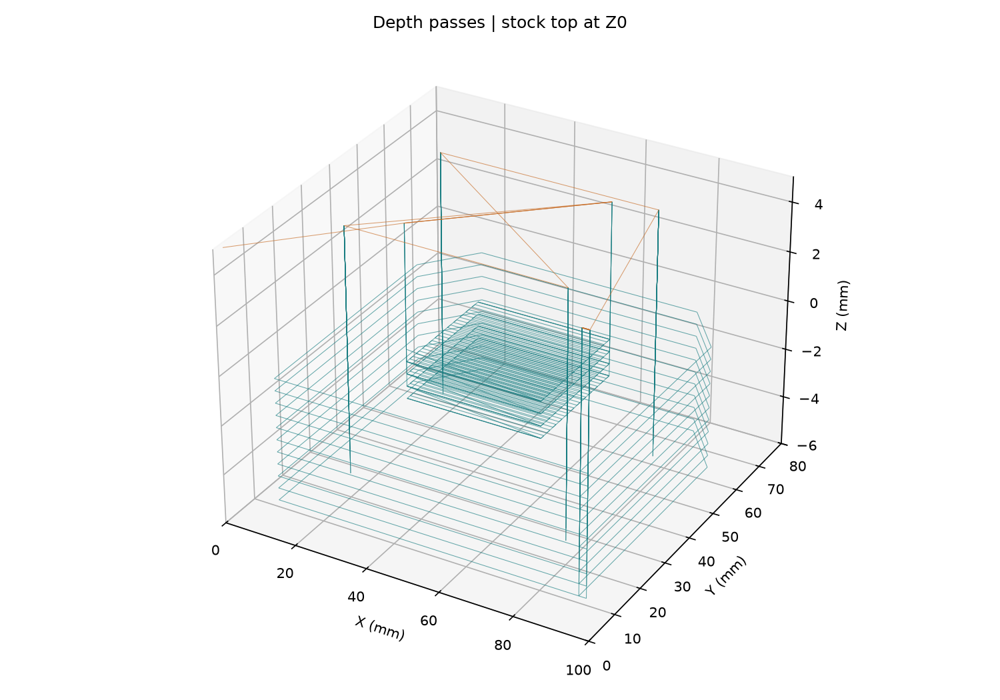

# gcode-toolpath-generator

I built a tool that plans cuts for a metal bracket to learn how the underlying idea works. This is a learning project.

## My sample part

I use a 100 × 80 × 6 mm block and a 3 mm centre-cutting end mill, a cutter that can also plunge straight down. The bracket has clipped corners, a 40 × 30 mm pocket cut 2 mm deep, and four 3 mm holes cut 5 mm deep. The outside cut reaches 5.5 mm, leaving a 0.5 mm floor to keep the part attached. These are blind holes, so they do not pass through the block.

Teal lines show feed moves, where the cutter travels at its programmed cutting speed. Orange dashed lines show rapid moves, which travel above the material. The pictures show the cutter's centre, so the outside path sits half a cutter width away from the part. The pocket has 1.5 mm inside corner radii because a round cutter cannot make a sharp inside corner.

## How I plan the cuts

I cut the pocket first using overlapping back-and-forth rows, then finish its walls. A ramp lead-in lowers the cutter gradually while it moves sideways, with a maximum slope of about 3 degrees. I drill the holes with pecks, short plunges with a full withdrawal between them. I cut the outline last, offsetting the cutter centre out by its radius and adding a straight tangent lead-in before each layer. The tool feeds back up to clearance height before every rapid move.

My material table includes illustrative carbide starting values for 6061 aluminum, acetal and mild steel. I calculate spindle speed from surface speed and cutter diameter, cap it at the configured spindle limit, then calculate feed from that actual speed, flute count and chip thickness. The table also limits the depth of each layer. I explain the values, formulas, input fields and G-code subset in [the design notes](docs/design.md).

## Tests and limits

There are 4 test source files in this copy. That source count does not establish an execution result. This is a source snapshot, and running it on a new machine may need environment-specific setup.

The relocated workflow did not complete successfully within the migration batch. Local test sources remain available.

No project-specific GitHub Actions workflow was retained. The local test sources remain in this folder.
