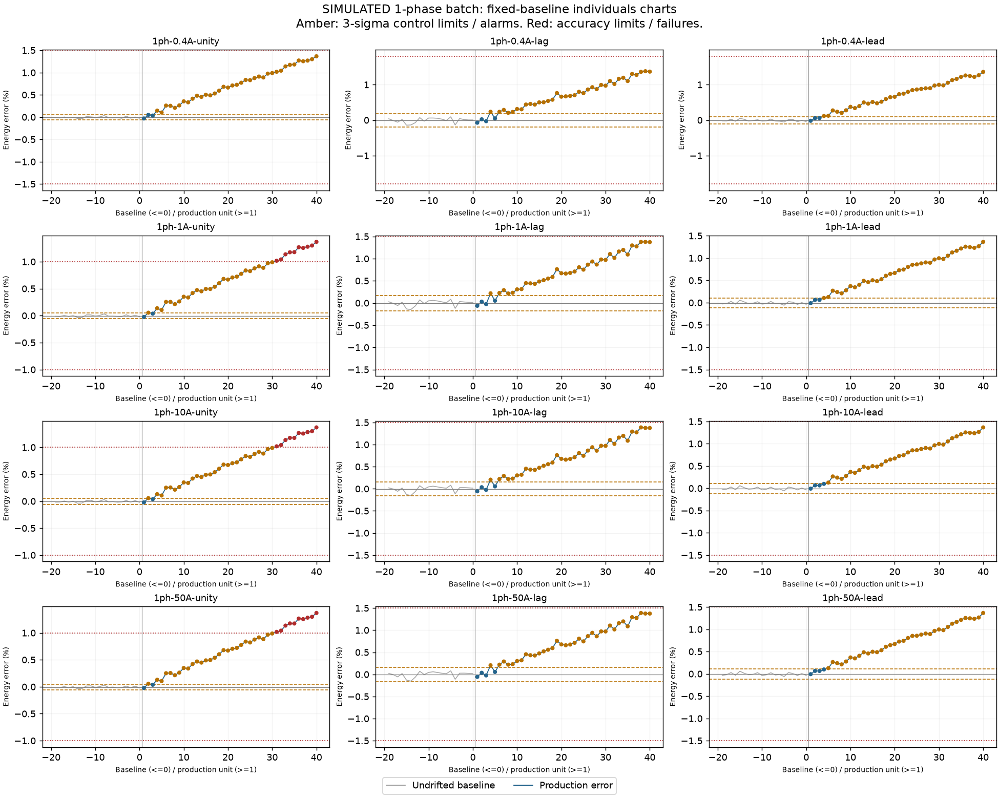
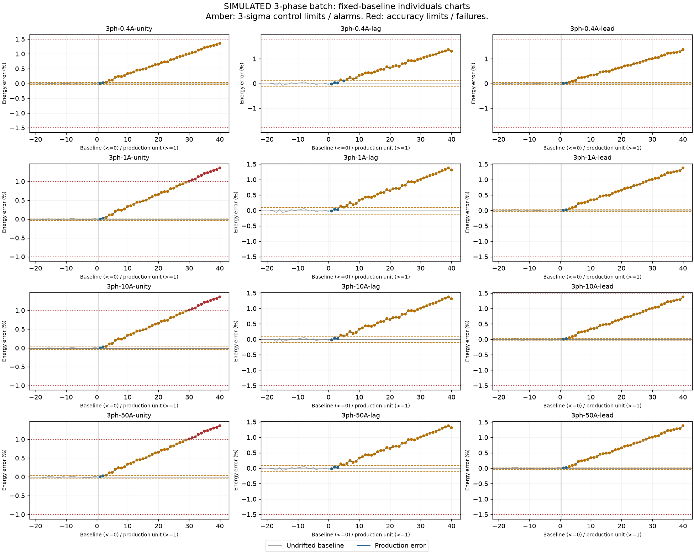

# Simulated batch report

SIMULATED DATA. Selected class B checks only. Not a certified test or calibration.

29/40 units passed every selected point.
First control alarm: 2; first failed unit: 30 (None means none observed).

Control alarms flag unusual variation; they do not change a unit's accuracy verdict.
Limits use a separate undrifted baseline for each load point, never this batch.

| Unit | Accuracy verdict | Failed points | Control alarms |
| --- | --- | ---: | ---: |
| UUT-001 | PASS | 0 | 0 |
| UUT-002 | PASS | 0 | 3 |
| UUT-003 | PASS | 0 | 8 |
| UUT-004 | PASS | 0 | 22 |
| UUT-005 | PASS | 0 | 19 |
| UUT-006 | PASS | 0 | 24 |
| UUT-007 | PASS | 0 | 24 |
| UUT-008 | PASS | 0 | 24 |
| UUT-009 | PASS | 0 | 24 |
| UUT-010 | PASS | 0 | 24 |
| UUT-011 | PASS | 0 | 24 |
| UUT-012 | PASS | 0 | 24 |
| UUT-013 | PASS | 0 | 24 |
| UUT-014 | PASS | 0 | 24 |
| UUT-015 | PASS | 0 | 24 |
| UUT-016 | PASS | 0 | 24 |
| UUT-017 | PASS | 0 | 24 |
| UUT-018 | PASS | 0 | 24 |
| UUT-019 | PASS | 0 | 24 |
| UUT-020 | PASS | 0 | 24 |
| UUT-021 | PASS | 0 | 24 |
| UUT-022 | PASS | 0 | 24 |
| UUT-023 | PASS | 0 | 24 |
| UUT-024 | PASS | 0 | 24 |
| UUT-025 | PASS | 0 | 24 |
| UUT-026 | PASS | 0 | 24 |
| UUT-027 | PASS | 0 | 24 |
| UUT-028 | PASS | 0 | 24 |
| UUT-029 | PASS | 0 | 24 |
| UUT-030 | FAIL | 3 | 24 |
| UUT-031 | FAIL | 6 | 24 |
| UUT-032 | FAIL | 6 | 24 |
| UUT-033 | FAIL | 6 | 24 |
| UUT-034 | FAIL | 6 | 24 |
| UUT-035 | FAIL | 6 | 24 |
| UUT-036 | FAIL | 6 | 24 |
| UUT-037 | FAIL | 6 | 24 |
| UUT-038 | FAIL | 6 | 24 |
| UUT-039 | FAIL | 6 | 24 |
| UUT-040 | FAIL | 6 | 24 |

Full unrounded point readings and citations: measurements.csv and report.json.

