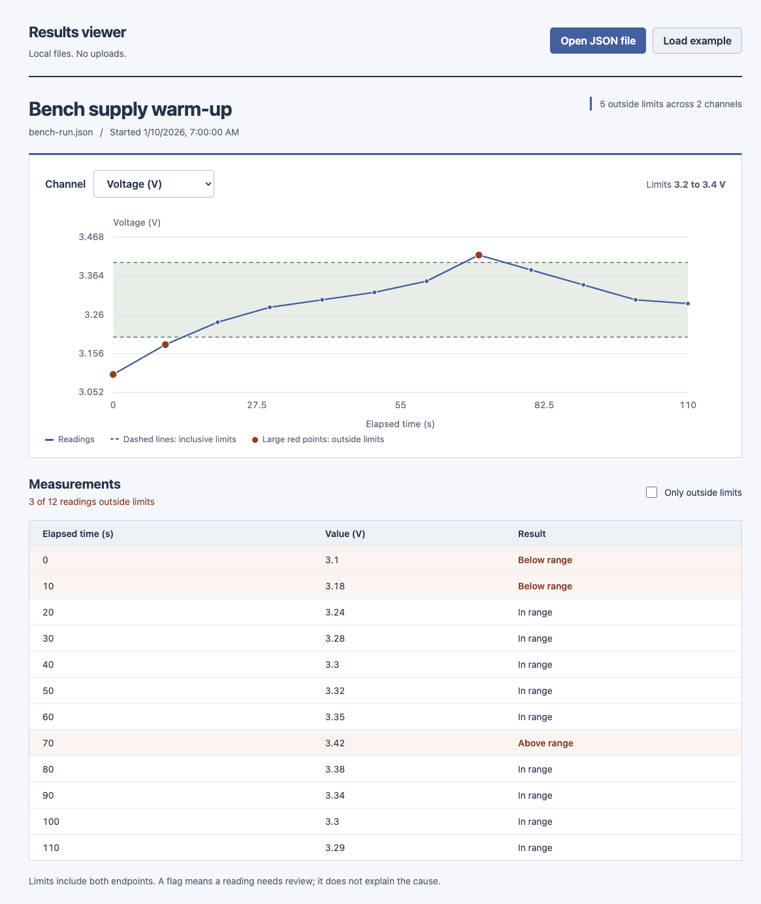

# vue-electron-results-viewer

I built a desktop viewer for test results to learn how the underlying idea works. This is a learning project.

## Try it

With [Node.js 24](https://nodejs.org/) and Git installed:

```sh
npm ci
npm start
```

Click **Load example** to open the included synthetic bench run. It has 24 readings across voltage and temperature, with five deliberately outside their limits. Choose a channel from the menu, then check **Only outside limits** to focus the table on the flagged readings.

To use my own results, I click **Open JSON file** and choose a file in the [documented format](docs/file-format.md). JSON is a text format for named values; [samples/bench-run.json](samples/bench-run.json) is a complete example to copy. The app accepts files up to 2 MiB and explains invalid files while keeping the previous valid run visible.



## What I look for

The blue line follows the readings over elapsed time. Dashed green lines mark the channel's lower and upper limits. Larger red dots show readings outside those limits, and the table labels them **Below range** or **Above range**. Readings exactly on either limit count as in range.

Each channel has its own unit and limits, so I can switch between voltage and temperature without mixing their scales. The table shows 100 readings per page; the chart keeps every reading visible. A flag tells me what needs review, not what caused it.

## Download a desktop build

The public [Desktop checks runs](https://github.com/jackaI1/vue-electron-results-viewer/actions/workflows/ci.yml) include downloadable `desktop-Linux` and `desktop-Windows` artifacts after a successful run. GitHub requires sign-in to download artifacts. Windows has an `.exe` installer. Linux has an AppImage and a `.tar.gz` archive; after extracting the archive, run `./results-viewer`. For the AppImage, make it executable first with `chmod +x *.AppImage`.

These builds are unsigned, so the operating system may show a warning. I have not tested the installer wizard itself or packaged macOS builds. On macOS, I use the source commands above.

## How I put it together

I use Vue 3 for the screen and Electron to run it as a desktop app with a native file picker. TypeScript checks the data contract between the screen and the part that reads files. That connection is called IPC, or inter-process communication. The screen gets just two methods: open a file and load the example. It gets no general file-system or Node.js access.

I validate the JSON before showing it, including finite numbers, ordered times, unique channel names and sensible limits. A custom SVG chart keeps the limits and flagged points inspectable, and the table provides the exact values. The [design notes](docs/design.md) explain the process boundary and tests in more detail.

## Tests and limits

There are 5 test source files in this copy. No test pass count is claimed here: I have not re-run the project suite as part of this move. This is a source snapshot, and running it on a new machine may need environment-specific setup.


Project checks run from this directory through the path-filtered hub workflows: (removed workflow).

The relocated workflow did not complete successfully within the migration batch. Local test sources remain available.
